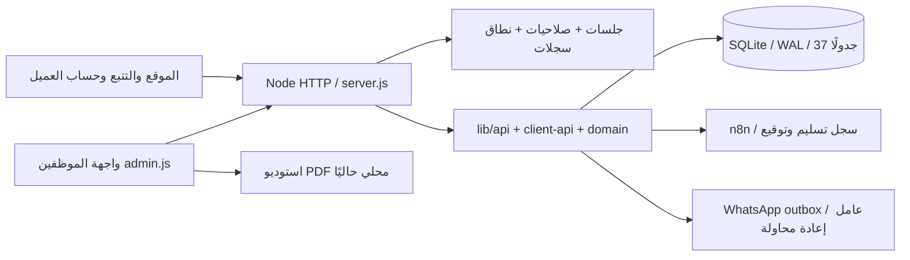

# Audit.md — تدقيق نظام الموظفين بعد مصالحة المرحلة 0.5

**الإصدار:** v3 — 31 أكتوبر 2026. **المصدر المدقق:** `main@882d5bb729047dc0a44f7602b01d961ac038d53d` (دمج PR #2).
**فرع هذه المراجعة:** `codex/employee-operations-audit-v3`. **المرجع:** `docs/employee-operations-spec-ar.md`، نسخة الملف المرفق v1.0.
**نوع التسليم:** تدقيق وخطة فقط؛ لا تعديلات تشغيلية ولا ترحيل إنتاج ولا نشر في هذا PR. حُفظ التدقيق السابق في `docs/audit/Audit-v2-historical.md`، والخطة السابقة في `docs/audit/Implementation_Plan-v2-historical.md`.

## 1. النتيجة التنفيذية

الأساس بعد 0.5 قابل للاحتفاظ به والتوسعة: CRM والفروع والأقسام والأدوار والتحويلات وn8n وواتساب أصبحت في شجرة موحدة. لا حاجة لإعادة كتابة الموقع أو القسائم. لكن **الاختبارات الخضراء لا تعني اكتمال التشغيل أو عزل الفروع**: أثبتت هذه المراجعة خمس فجوات جديدة على قاعدة مصطنعة، بينها ثلاثة أعطال SQL وتجاوز صلاحية قبول تحويل بين فرعين. تبدأ المرحلة التالية بإغلاقها قبل بناء واجهات إضافية.

المخطط يحتوي 37 جدولًا، خمسة تعريفات أدوار افتراضية، 16 رمز صلاحية، 85 تسجيل router ثابتًا في المصدر و43 معالج API مشارًا إليه مباشرةً؛ كل المعالجات المشار إليها موجودة. العدد 85 ليس عدد المسارات النهائي لأن هناك تسجيلات داخل حلقات وموارد ديناميكية. `PRAGMA user_version=0`: لا يوجد مشغّل ترحيلات مرقّم. فحوص مخطط القاعدة المصطنعة: integrity=ok و0 أخطاء FK. لا تمثل هذه الأعداد عدد العملاء أو الطلبات أو الموظفين في الإنتاج.

## 2. منهج التدقيق وحدوده

- قراءة المرجع المرفق، ومراجعة server/router، ملفات lib للمصادقة وAPI والعملاء والمجال وقاعدة البيانات وHTTP والتكاملات، وواجهات الإدارة والحساب والموقع والقسائم وملفات الاختبار وCI والنشر. استُخدمت تقارير التدقيق التفصيلية السابقة كمرجع، ثم أُعيد التحقق من النقاط الرئيسية على main الحالي.
- تشغيل المجموعة الكاملة والدخان، وجرد المخطط من SQLite في الذاكرة، وبروبات صلاحيات اصطناعية قابلة للتكرار عبر `node tools/audit-current.mjs`.
- فحص إنتاج **GET فقط بلا كوكيز** عبر `node tools/audit-production-readonly.mjs`: تسع صفحات/صحة، ثلاث واجهات إدارة بلا جلسة، وملفا JS. لم تُقرأ صفوف عملاء أو أسرار أو كلمات مرور.
- لم تتم مراجعة واجهة موظف مصادق عليها في الإنتاج، ولا تجربة مستخدم بصرية شاملة/جوال/قارئ شاشة، ولا قياس LCP/TTI، ولا فحص قرص Render أو نسخة قاعدة بياناته أو حسابات Meta/n8n/البريد. هذه أمور غير مثبتة وتحتاج بيئة staging ووصولًا مناسبًا.
- أرشيف مصدر محلي قبل التدقيق: `data/pre-audit-v3-882d5bb-source.zip` (كود/اختبارات/أصول/إعدادات بناء فقط؛ دون قواعد أو .env أو بيانات عملاء). SHA256: `9D96B484803B45D3C6572D50397AFF959956D3F5F3BFC8B22ACBC2431257CEA2`. المستودع والفرع الاحتياطي السابق باقٍ. لم تُنشأ نسخة إنتاج؛ لا تُخلط نسخة المصدر بنسخة البيانات.

## 3. البنية الحالية وما يستحق الاحتفاظ

| الموجود | الاحتفاظ والتحسين |
|---|---|
| Node 22.5+/24 وSQLite WAL، دون اعتماديات npm خارجية | إبقاء المكدس؛ فصل الوحدات تدريجيًا، وعدم استبداله أثناء تطوير الموظفين |
| scrypt وجلسات موظفين 8 ساعات، httpOnly/SameSite، إبطال عند تغيير كلمة المرور/التعطيل، must_change خادمي | الاحتفاظ بالتدفق؛ حد 12 حرفًا، عبارات مرور، توحيد policy، MFA للمسؤولين بعد قرار المالك |
| role_definitions وbranch/department/assigned scopes | توسيع التفويض الحالي؛ لا بناء منظومة صلاحيات ثانية موازية |
| فروع وأقسام وموظفون/مستخدمون وإدارة أدوار | إضافة ملف موظف وعضويات وتعديل/تعطيل مضبوط؛ الحفاظ على IDs والجلسات المعتمدة |
| استقبال سبعة أنواع طلبات، مرجع فريد، كشف تكرار مؤقت، عملاء، تتبع | إبقاء publicStatus وعقد API العام والأعمدة القديمة أثناء توسعة دورة العمل |
| تحويل بقبول/رفض ومعاملة وسجل ملكية | سد النطاق والملكية وإضافة إشعارات؛ لا استبدال request_transfers |
| تقارير أداء وCSV وعرض سعر وتتبع أحداث | تدقيق التعريفات والمنطقة الزمنية والصلاحيات، ثم إضافة تقارير جديدة |
| استوديو قسائم وPDF ومكتبات وخطوط محلية | الحفاظ على القوالب؛ إضافة حفظ وإصدارات وأرشيف بدل إعادة الرسم |
| برامج وعروض ومحتوى وواجهة عربية/إنجليزية | إبقاء الهوية Cairo والألوان والشعار والروابط؛ طبقة مراجعة وإصدارات للاستيراد |
| عميل/OTP بالبريد وفصل client_sessions | الإبقاء على حساب العميل مستقلاً؛ اختبارات ارتباط وعزل قبل كل ترحيل |
| n8n وتوقيع HMAC/مفتاح Header، وسجل webhook_deliveries؛ outbox واتساب | الحفاظ على الاثنين؛ إصلاح رؤية السجل ومؤشرات الإعداد ومراقبة الفشل |

## 4. النتائج المثبتة ذات الأولوية

الاختبارات الاستكشافية التالية **ليست هجمات على الإنتاج**؛ جميع السجلات والحسابات في `:memory:`. ملف audit-current تشخيص لحالة v3 ويتوقع السلوك المعيب؛ ليس اختبار قبول أو جزءًا من CI. بعد الإصلاح يُستبدل توقعه باختبارات انحدار إيجابية/سلبية.

| المعرف/الأولوية | الدليل | النتيجة والأثر |
|---|---|---|
| SQL-01 / P1 | `lib/api.js:708–714`, `914–919`, `1097–1106`؛ requestScope يولد `r.*` لكن الاستعلامات تفتقد alias | PATCH طلب، POST تحويل، GET تفاصيل عميل لمستخدم branch: **500/500/500**؛ المدير العام ينجح لأن scope فارغ. إصلاح alias في هذه المواضع مع اختبارات branch/department/assigned والسجل الخارجي |
| ACL-01 / P1 | `lib/api.js:1012–1021`؛ قبول التحويل بدور department لا يفحص فرع المستلم عند القسم المشترك | موظف قسم في فرع A قبل تحويلًا موجّهًا لفرع B وموظف آخر: **200 بدل 403**. لا تغير الملكية أو الحالة قبل رفض التفويض |
| ACL-02 / P1 | `lib/api.js:606–621` | مستخدم branch لديه overview:read يرى سجل تسليم عام ومرجع طلب بفرع آخر: **200 مع المرجع**. يلزم صلاحية تكامل مستقلة ونطاق أو حجب السجل لغير الإدارة |
| AUTH-01 / P1 | `server.js:186–201` | غلاف api(action) يتحقق من وجود جلسة فقط؛ الفحص التفصيلي يعتمد على requireUser داخل كل معالج. لا تثبت هذه الملاحظة تجاوزًا لكل المسارات؛ المطلوب دفاع مركزي ومصفوفة تمنع إضافة معالج غير محمي |
| DB-01 / P1 | `lib/db.js:523–715` وuser_version=0 | تعديلات مخطط وbackfill عند الإقلاع دون دفتر ترحيل/نسخ تلقائي موثق قبلها. إعادة بناء requests موجودة؛ صلح حفظ client_id في 0.5. يلزم تحكم ونسخ/استعادة قبل تغييرات جديدة |
| FLOW-01 / P1 | `lib/api.js:1030–1058`, requestScope:134–136 | القبول يغير assigned/service فقط؛ sales/execution قد يبقيان بالفرع السابق، وCOALESCE يبقي المالك القديم عند التحويل إلى قسم بلا مستخدم. يلزم قرار ملكية صريح وصندوق غير مخصص مرئي وسجل متسق |
| AUDIT-01 / P1 | `lib/db.js:407–418`, `lib/domain.js:552` | audit_log يسجل action/meta دون before/after/reason أو حماية DB من UPDATE/DELETE؛ ليس سجلًا كاملًا مطابقًا للمواصفة |
| CRUD-01 / P2 | `lib/api.js:1306–1325` | مسار حذف محتوى نهائي موجود، مع أرشفة البرامج المرتبطة فقط؛ لا يحذف هذا التدقيق شيئًا. يجب تحويل السياسات الجديدة إلى تعطيل/أرشفة وعدم ترحيل حذف عام |
| AUTH-02 / P2 | `lib/api.js:99,1482,1591`؛ `lib/auth.js:96` | حد كلمة الموظف 10 أحرف، ومحاولات الدخول Map ذاكرة؛ لا MFA ولا عضويات متعددة. دعم عبارات مرور عربية لا يوافق حاليًا شرط الحرف اللاتيني |
| TIME-01 / P2 | `lib/api.js:348,369–394,511` | احتساب اليوم وفترات التقارير UTC؛ المطلوب Asia/Amman مع اختبارات منتصف الليل |
| UX-01 / P2 | `public/assets/js/app.js:8–17` وaccount.js | انتظار اصطناعي 2000ms بدل هدف 150–250ms، وتنقل الموظفين خطي بلا بحث موحد/جرس/مهام. لا تغيير شامل للموقع العام قبل قياس وتوافق |
| MEDIA-01 / P2 | `lib/http.js` securityHeaders | Permissions-Policy يمنع microphone؛ إضافة تسجيل صوت تتطلب سماحًا محدودًا للواجهة اللازمة بعد الموافقة، مع بقاء حماية الرفع والوصول |

إصلاحات 0.5 السابقة ليست فجوات مفتوحة: updateUser alias/تصعيد role، منح صلاحيات الأدوار، must_change، CSRF، جدول outbox، ربط الاستلام، حفظ client_id، تعريف الطباعة والاستيراد المفقود. اختبارات المرحلة باقية وناجحة. قضايا SQL-01 تخص معالجات أخرى لم تُغطَّ سابقًا؛ الاختبار القديم ينشئ التحويل كمدير عام، فيخفي عيب scope.

## 5. المطابقة مع المواصفة المرفقة

| بند المرجع | الحالي | الفجوة المطلوبة |
|---|---|---|
| §2 الهوية/RTL/السرعة | هوية وخطوط وRTL/إنجليزية موجودة | وصول وجوال وتحميل وخطأ وفراغ وحركة قصيرة وقياس فعلي |
| §3 الهوية والأدوار | 3 base roles + 5 تعريفات ونطاق واحد للمستخدم | أدوار مالك/GM/مالية/قارئ تقارير، إجراءات دقيقة وعضويات متعددة، profile موظف وMFA |
| §4 التنقل | 15 قسمًا في SECTIONS | تخطيط عمليات متدرج، بحث سريع وإنشاء وجرس ومبدّل فرع دون أزرار بلا وظيفة |
| §5 لوحات القيادة | overview وتقارير عامة مقيّدة جزئيًا | لوحتا موظف/مدير حقيقيتان وdrill-down؛ تمييز التقديري/المحقق |
| §6 دورة الطلب | 7 حالات وdeal_status وعرض واحد وتحويلات وسجل | طبقة حالات عمل منفصلة للتوافق، أولوية/استحقاق/متابعة وأسباب نهائية وصندوق غير مخصص |
| §7 المهام | لا tasks/comments/attachments؛ request_follow_ups جدول غير موصول بواجهة/API مستقلة | مهام/قائمة/Kanban/صوت/رفع خاص وتعليقات وذكر وSLA |
| §8 الإشعارات | outbox واتساب؛ لا مركز إشعارات داخلي أو تعاميم | notifications/announcements/إقرار قراءة وعدّاد وروابط وإعادة محاولة غير مكررة |
| §9 القسائم | PDF محلي وlocalStorage؛ نوعا flight/travel | فندق مستقل، UUID/مرجع سنوي/حفظ/أرشيف/نسخ وروابط محمية؛ لا حذف لقوالب أو بيانات سابقة |
| §10 البرامج والاستيراد | CRUD وموقع منشور | تصنيفات قابلة للإدارة، صلاحية وتكلفة/سعر/إصدارات/ملف أصلي، استخراج ومقارنة واعتماد بشري قبل النشر |
| §11 التقارير | CSV ومبيعات مشتقة من الطلبات | تعريف KPI وAsia/Amman وتكلفة/تحصيل موثق؛ لا ادعاء ربح من قيمة الطلب |
| §12 الصرف | لا مزود أو snapshots أو widget | مصدر وتوقيت/انقطاع/cache وتمييز إرشادي، دون سعر ثابت مفترض |
| §13 إضافات | قاعدة معرفة وتكاملات وأحداث موجودة | قائمة تحقق ومخاطر سفر/إصدار وصحة نسخ/وظائف |
| §15 البيانات | جداول bookings/payments/quotes/follow_ups موجودة | لا دليل API يكتبها حاليًا؛ يُعاد استخدامها بدل نماذج تسعير وحجوزات موازية |
| §17 الأمن | CSRF/CSP/scrypt/جلسات/حدود معدل | إغلاق P1 أعلاه، حماية مرفقات وتدقيق غير قابل للمحو ومراقبة واستعادة مثبتة |
| §18–19 التسليم | 0 و0.5 تمتا وPR #2 اندمج بموافقة سابقة | مراحل 1–6 لم تبدأ؛ معايير قبول مستقلة واختبارات وPR لكل مرحلة |

## 6. الاختبارات والتحقق المحدث

| الفحص | النتيجة |
|---|---|
| `npm test` على Node 24.22.1 | **86/86**، 0 فشل، 0 تخطي |
| `npm run smoke` | **27/27** على قاعدة محلية مصطنعة |
| `node tools/audit-current.mjs` | **5/5 فجوات أُعيد إنتاجها** (3 SQL + 2 تفويض/رؤية)، exit 0 يعني نجاح التشخيص وليس إصلاح الفجوات |
| SQLite في الذاكرة | 37 جدولًا؛ 5 تعريفات؛ user_version=0؛ integrity=ok؛ FK=0 |
| فحص الإنتاج العام | **14/14**: 9 ردود 200 للصفحات/الصحة، 3 ردود 401 صحيحة للإدارة بلا جلسة، وملفا JS برمز 200 وبصمة مطابقة للمصدر المدقق |
| حماية التراث | اختبارات API 54، لغة 8، قسائم 5، webhooks 9، أمن 0.5 عدد 8، ترحيل/استعادة 2 |

سجلات محلية مستثناة من Git: `data/audit-v3-tests.log`, `data/audit-v3-smoke.log`, `data/audit-v3-probes.log`, `data/audit-v3-live.log`. لا تُرفع سجلات إنتاج أو بيانات عملاء. فحص JS المطابق يؤكد وصول هذين الأصلين إلى الموقع، وليس بصمة الخادم أو نجاح كل تكامل خارجي.

## 7. القرار التالي

تبدأ المرحلة 1A بإغلاق SQL-01 وACL-01 وACL-02، ومصفوفة أدوار/فرعين، ودفاع الغلاف، ثم الأساس الآمن. باقي التسلسل ومعايير القبول والإعدادات في `Implementation_Plan.md` v3. وفق شرط المالك السابق، لا يبدأ كود المرحلة 1–6 قبل اعتماده نتائج 0.5 وخطة المرحلة التالية؛ الطلب الحالي يبدأ بالتدقيق، وهذا الـPR لا ينفذ وظائف جديدة ولا يدمج أو ينشر.
