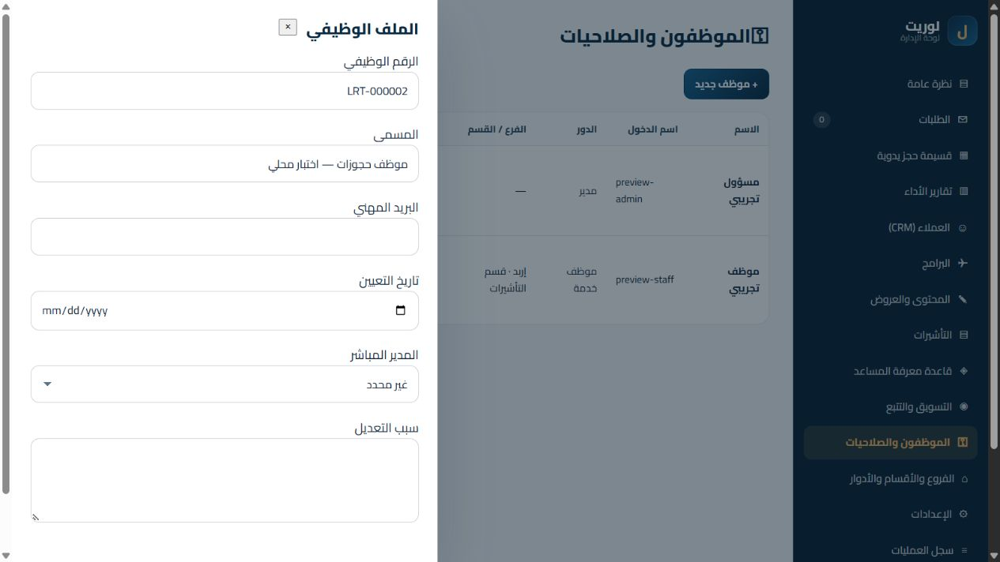

# المرحلة 1B — تقرير التسليم للمراجعة

التاريخ: 31 أكتوبر 2026. الأساس: `main@5506707` بعد نشر 1A. الفرع: `codex/employee-operations-phase-1b`.
التفويض: بدء1B، ثم اختيار المالك تفعيل MFA للمسؤولين الآن. هذا التسليم لا يدمج أو ينشر ولا يبدأ1C أو2–6.

## المنجز

- مشغل ترحيلات مرقم: baseline=1 ثم هوية=2، دفتر `schema_migrations` مع checksum وبصمة المخطط؛ رفض نسخة قاعدة أحدث أو اختلاف checksum/مخطط بدل محاولة إصلاح صامتة.
- snapshot SQLite متسق عبر VACUUM INTO قبل كل خطوة على قاعدة موجودة، مع integrity/FK قبل وبعد. كل خطوة داخل معاملة؛ فشلها يلغي كامل الخطوة ولا يرفع الإصدار. الترحيل القديم يرفض أي أعمدة طلب غير معروفة بدل إسقاطها.
- المخطط الحالي في الاختبار **43 جدولًا** بدل37؛ الإضافات: schema_migrations، employees، staff_memberships، staff_login_attempts، staff_mfa، staff_mfa_challenges. أضيفت أعمدة سياق/MFA للجلسات وbefore/after/reason للتدقيق. لا جدول أعمال قديم محذوف.
- ملف موظف لكل مستخدم تلقائيًا مع رقم وظيفي مبدئي فريد `LRT-*`، مسمى ومدير وتاريخ تعيين وبريد مهني؛ تحقق من التكرار ودورات المدير ومن نطاق من يعدل. الرقم المبدئي ليس ادعاء بمطابقة سجل الموارد البشرية؛ يمكن للمخول تصحيحه.
- عضوية أساسية محفوظة وعضويات إضافية صريحة في فرع/قسم ودور محدد. تبديل سياق الجلسة يدوّر الرمز ويطبق صلاحيات العضوية المختارة؛ إلغاء التفويض أو تغيير السياق الأساسي/التعطيل يسحب الجلسات فورًا. لا جمع تلقائي لكل صلاحيات الفروع.
- نطاق القسم يطابق **الفرع والقسم** في قراءة الطلبات والموظفين والتحويلات الواردة؛ لا إنشاء أو نقل موظف عبر فرع آخر بحجة القسم المشترك. حساب ذو دور branch/department ناقص الربط يفشل مغلقًا بدل التحول إلى نطاق عام.
- قوالب إضافية: مدير عام، محاسب، مدقق، قارئ تقارير؛ مع الخمسة السابقة يصبح عدد التعريفات الافتراضية9. المحاسب هنا قارئ للتقارير الموجودة، وليس نظام محاسبة جديدًا.
- إجراءات مستقلة للإسناد والتحويل والتأكيد وتصدير التقارير وحذف المحتوى وإدارة حساب المسؤول. تُوسع منح الأدوار القديمة فقط إلى الأكواد التي تفصل أفعالًا كانت متاحة أصلًا؛ لا يجري تعيين أدوار جديدة للمستخدمين تلقائيًا. legacy العام باقٍ للتوافق حتى يراجعه المالك ويعين الأدوار المحدودة صراحةً.
- كلمة مرور الموظف الجديدة 12–128 محرفًا وتدعم عبارات مرور عربية؛ كلمات المرور القديمة ذات hash صالح لا تُبطل لمجرد طولها، وmust_change باقٍ. قفل محاولات دخول الموظفين أصبح في DB بمفتاح مهشّم ويستمر بعد إعادة التشغيل؛ حساب العميل منفصل وسياساته لم تتغير.
- MFA إلزامي للأدوار ذات صلاحيات الإدارة الحساسة: TOTP، إعادة إثبات كلمة المرور عند التسجيل، تشفير سر TOTP بـAES-256-GCM، رموز استعادة10 تظهر مرة واحدة وتُحفظ مهشمة، منع إعادة استخدام الرمز، وتحديات قصيرة العمر ومحدودة المحاولات. التحقق واستهلاك الرمز وإنشاء الجلسة معاملة ذرية، وتغيير كلمة المرور/التعطيل يبطل التحديات المعلقة. اختيار عضوية إدارية لا يتجاوز بوابة MFA.
- تغطية قبل/بعد عبر triggers للطلبات والعملاء والهوية والهيكل والعضويات، مع actor/IP/reason معزولة لكل طلب عبر AsyncLocalStorage. حقول كلمات المرور وOTP/الأسرار والحمولات الحساسة لا تدخل فروق السجلات؛ metadata الجديدة منقحة. منع UPDATE/DELETE لسجل التدقيق من DB؛ سجل قديم لم يُمحَ أو يُعاد كتابته.
- تصدير آخر1000 سجل في وثيقة موقعة HMAC-SHA256 بمفتاح خادم مستقل وصلاحية audit:export ونطاق مؤسسة، مع تسجيل عملية التصدير. هذا توقيع للوثيقة المصدرة؛ ليس وعدًا بسلسلة blockchain أو حصانة أمام مالك ملف SQLite.
- واجهات فعلية: دخول MFA وتسجيله، الملف الوظيفي، تفويضات العمل، اختيار سياق العمل، تعديل/تعطيل الفروع والأقسام مع منع تعطيل جهة عليها موظفون/نشاط/تحويلات، عرض فروق التدقيق والتصدير. هوية الموقع العام والقسائم باقية.

## الملفات

| المجموعة | الملفات |
|---|---|
| الترحيلات | lib/db.js، lib/migrations.js |
| الهوية/MFA | lib/auth.js، lib/staff-mfa.js، lib/staff-api.js، lib/api-authorization.js، server.js |
| الصلاحيات والتدقيق | lib/api.js، lib/domain.js، lib/audit-context.js |
| الواجهة | public/assets/js/admin.js |
| الاختبارات | tests/phase1b.test.js، tests/helpers/staff-auth.mjs، tests/fixtures/pre-identity-crm.sql؛ تحديث تجهيز api/phase05/phase1a/webhook/migration للتدفق الحقيقي والسياسة الجديدة |
| إعدادات/توثيق | .env.example، .gitignore، Execution_Checklist.md، PR_DESCRIPTION.md، docs/phase1b-operations-ar.md، هذا التقرير ولقطة synthetic |

## التحقق بالأرقام

- `npm test`: **125/125**، 0 فشل، 0 تخطي، exit0. الزيادة **22 اختبارًا** فوق103 في1A.
- مصفوفة مسارات الإدارة: **72×3=216** طلب رفض HTTP بلا تغييرات أعمال. مصفوفة قدرات الأدوار الموجودة: **8×72=576** قرارًا؛ ليست إنشاء ثمانية أدوار جديدة.
- `npm run smoke`: **27/27**، exit0. اختبارات حساب العميل وOTP والتتبع والقسائم واللغتين وn8n القديمة ما زالت ناجحة.
- ترحيل المخططين التاريخيين26 و36 إلى43، مع حفظ أعمدتهما وسجلاتهما المصطنعة واستعادة النسخة السابقة. كذلك اختبار قاعدة37 قبل الهوية ونسخ WAL وفشل خطوة وتغير المخطط ونسخة أحدث وأعمدة غير معروفة.
- اختبارات MFA تشمل قيمًا مستقلة من [RFC6238 Appendix B](https://www.rfc-editor.org/rfc/rfc6238#appendix-B)، وتسجيلًا حقيقيًا عبر API، وتشفيرًا، واستعادة أحادية الاستخدام، وقفلًا، وتعطيلًا، ومنع التصعيد عبر العضوية. استُخدمت مفاتيح مصطنعة داخل الاختبارات فقط.
- تحقق متصفح محلي بقاعدة `:memory:` وموظفين مصطنعين: دخول عبر تحدي MFA ورمز استعادة، فتح الملف وحفظ مسمى ثم فتحه والتأكد من استرجاعه، فتح نموذج التفويضات، وأدوات تعديل الفروع والأقسام. كشف الفحص خطأ ربط أزرار وعولج قبل التسليم.
- لا ادعاء باختبار MFA على حساب مسؤول حقيقي، أو بإجراء E2E لكل سيناريو جوال/وصول/تكامل خارجي؛ ذلك ضمن staging ومرحلة الصقل. CI على Node22/24 يراجع في PR.

## النسخ والبيانات والرجوع

لم تُفتح أو تُرحّل قاعدة الإنتاج. كل الكتابات والتحقق على قواعد مصطنعة محلية. نسخة المصدر السابقة `data/pre-phase1b-source.zip` مستثناة من Git، دون DB/.env أو بيانات عملاء؛ SHA256: `5D4283D648C6E87C253AF1BBA016759EFC8D014E3CB9C583576BED0589E59197`.
نسخ الترحيل تحت `backups/` بجانب ملف DB، وملفات الاختبار تحت data/phase1b-testing وdata/phase05-migration مستثناة من Git. snapshots لقواعد حقيقية ستحتوي بياناتها الخاصة؛ تبقى على الخادم بصلاحيات ملف مقيدة ولا تُرفع إلى المستودع. تفاصيل التهيئة والاستعادة في دليل العمليات.

## متطلبات قبل أي نشر لاحق

1. إعداد `STAFF_MFA_ENCRYPTION_KEY` ثابتًا (Base64 لـ32 بايت عشوائيًا) في أسرار Render؛ لا يرسل هنا أو إلى PR. غيابه يمنع تسجيل MFA واستخدام صلاحيات المسؤول، مع بقاء الموقع العام متاحًا. تغيير المفتاح دون خطة إعادة تشفير يعطل فك الأسرار القديمة.
2. إعداد `AUDIT_EXPORT_KEY` مستقل إذا أريد تفعيل التصدير الموقّع؛ عرضه أو إرساله للمتصفح ممنوع. قراءة سجل التدقيق تعمل بدونه، أما التصدير فيعيد503 برسالة واضحة.
3. مراجعة حقول الموظفين وأرقامهم والأدوار legacy وعضوياتهم في staging؛ لا يُفترض أن بياناتهم الإدارية مكتملة من backfill.
4. مراجعة نسخ البيانات والقرص والوصول إليها، والاحتفاظ بنسخة خارجية آمنة من DB ومفتاح MFA عبر قناة أسرار منفصلة. السياسة الحالية لا تحذف سجلات التدقيق أو snapshots آليًا؛ يحدد المالك مدة الاحتفاظ/الأرشفة قبل اعتماد التشغيل الطويل.
5. موافقة منفصلة على الدمج والنشر. لم تُضبط أسرار الإنتاج ولم يبدأ1C أو2–6.
