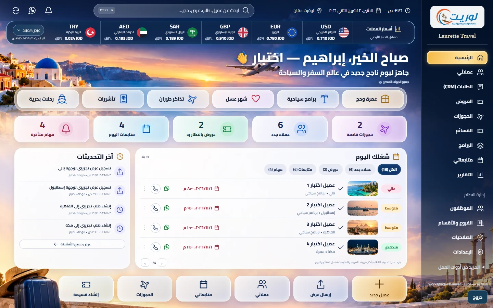

# تسليم Laurette Workspace للمراجعة

2 نوفمبر 2026. الفرع feature/employee-operations-os. أساس التغيير d5571968857c875ef29dd3dd9fe483e855ed6f55 من فرع المرحلة6؛ المراحل3–6 ما زالت مراجعات غير مدمجة. هذا التسليم لا يمنحها اعتمادًا ولا ينشرها.

## النتيجة

أُعيد بناء الرئيسية حول الصورة المرفقة: خلفية سياحية، Sidebar يمين داكن، الشعار الرسمي، البحث والساعة بتوقيت عمّان والجرس وواتساب الشركة، شريط العملات،6 خدمات،5 مؤشرات، شغل اليوم، الأنشطة و6 إجراءات. جميعها عناصر فعلية وليست صورة واجهة ثابتة. الصفحات الأخرى احتفظت بتصميمها؛ الإضافات فيها تمرير كلمات البحث فقط.

## الربط الفعلي وتعريف الأرقام

- أضيف workspace إلى GET /api/admin/overview الموجود؛ لم يُنشأ API CRM منافس. الصفوف والأنشطة محدودة بأربع لكل صفحة. النطاق يتبع الفرع والقسم والملكية والعضوية النشطة مع صلاحية كل مصدر.
- العملاء الجدد: عملاء CRM أنشئوا خلال يوم عمّان ولهم طلب مرئي، لا عدد الطلبات المكررة. انتظار الرد: الطلبات بحالة quoted. المتابعات: المفتوحة المستحقة اليوم. المتأخر: مهام مفتوحة موعدها مضى. الضغط على المؤشر يطابق تعريفه؛ قائمة العمل العامة تشمل المتأخر واليوم وقد ترتبط عدة بنود بنفس الطلب.
- الحجوزات القادمة: مواعيد قسائم طيران/فنادق صادرة بإصدار حالي لطلبات مؤكدة. التاريخ من snapshot الإصدار، لا من وقت التأكيد. لا يُدّعى أنها كل حجوزات الشركة.
- الأنشطة من request_events/task_events الفعلية؛ لا أحداث مشاهدة عروض أو اهتمام عميل مختلقة.
- البحث يستخدم APIs الطلبات والعملاء والبرامج والقسائم القائمة حسب الصلاحية، مع تأخير وإلغاء البحث السابق ونتائج محدودة. Ctrl+K، أسهم وEscape مدعومة.
- «عميل جديد» يفتح نموذجًا يوضح أنه يحفظ العميل مع طلب استشارة، ثم ينفذ مسار الاستقبال الموجود ويفتح الطلب. لا إنشاء طلب خفي. «إرسال عرض» يوجه لاختيار طلب العميل؛ الهاتف وواتساب يستخدمان رقم السجل؛ الأقسام والقسائم والمتابعات تفتح الأدوات الحالية.

## الأمان والحفظ

لم تتغير آلية المصادقة أو مخطط DB. بقي must_change وMFA وCSRF ونطاق البيانات على الخادم. أضيف منع لاستخدام استقبال الطلبات لتغيير اسم عميل موجود خارج نطاق الموظف، وتحديث صلاحية الجلسة بعد قراءة الجسم. حقول overview القديمة أصبحت تحجب بيانات CRM عن أدوار لا تملك requests:read بدل كشفها عبر صلاحية overview وحدها. بقي عقد الحقول للأدوار المخولة.

العملات محفوظة في جدول meta القائم؛ تغييراتها متسلسلة revision لمنع الكتابة المتعارضة، داخل transaction مع audit لكل عملة والسبب والقيم قبل/بعد. صلاحية exchange:manage حساسة وتتطلب نطاق المؤسسة وMFA. لا URLs أو مفاتيح مزود من المتصفح، ولا أسرار جديدة في المستودع.

## العملات والإعداد المتبقي

الافتراضي USD/EUR/GBP/SAR/AED/TRY، حتى12 معروضة و30 مدعومة. الحاسبة إرشادية ولا تغير البيع أو الدفاتر. كل قيمة تحمل مصدرًا ووقتًا وصلاحية وحالة يدوي/API/بديل/قديمة/غير متاح. لا أرقام سوق افتراضية.

عقد المزود في lib/exchange-rates.js جاهز، ويدخل ككود موثوق عبر createApp({exchangeRateProvider}). لا مزود خارجي مهيأ أو اشتراك مشترى؛ لذلك الإنتاج سيعرض «المصدر غير مهيأ» حتى إعداد مصدر فعلي أو اعتماد أسعار يدويًا من مسؤول مخول. تحديث5دقائق، مهلة5ثوانٍ، طلب موحد متزامن وآخر نسخة سليمة موسومة. لم تتغير أسعار البرامج أو سياستها في المراجعة والنشر.

## الملفات

| المجموعة | الملفات |
|---|---|
| الربط والبيانات | lib/workspace-data.js، lib/api.js، server.js |
| العملات | lib/exchange-rates.js، lib/staff-mfa.js |
| الواجهة | public/assets/js/employee-workspace.js، public/assets/css/employee-workspace.css، public/assets/js/admin.js |
| روابط الأقسام والكاش | public/assets/js/program-workspace.js، public/assets/js/voucher-ledger.js، lib/views/layout.js |
| الأصول | public/media/workspace/؛ تفاصيل المصدر والتوليد في workspace-assets.md |
| الاختبارات | tests/workspace.test.js، tests/helpers/workspace-fixture.mjs، tools/workspace-browser-acceptance.mjs، .github/workflows/phase3-voucher-browser.yml |
| التوثيق | تدقيق ما قبل التنفيذ، هذا التسليم، وتقرير المراحل1–6 |

## التحقق المحلي

| الفحص | النتيجة |
|---|---|
| npm test |244/244، صفر فشل وتجاوز وإلغاء؛ منها16 اختبارًا جديدًا |
| npm run smoke |27 فحصًا، SMOKE OK |
| قبول المتصفح |12/12 مجموعة، صفر أخطاء JavaScript |
| axe-core 4.10.3 |6 شاشات، صفر مخالفات مؤكدة |
| المقاسات |1672×941 و1440×900 و1024×900 و800×900 و390×844 و320×740؛ بلا تمرير أفقي للصفحة |
| الوظائف | دخول موظف محدود، إخفاء إدارة العملات، رفض PATCH غير المخول، إضافة عميل/طلب حقيقية، البحث، الصفحات، النشاط، العملات والحاسبة، الخطأ وإعادة المحاولة، قائمة الهاتف، Ctrl+K وحركة مخفضة |

فُحصت اللقطات فعليًا وقورنت بالصورة المرجعية؛ عُدلت نسب البطاقات والنصوص وشريط العملات وأحجام اللمس. مشكلة قابلية تركيز شريط العملات الأفقي كُشفت وأُصلحت بدل تعطيل فحص الإتاحة. حالات color-contrast غير المحسومة آليًا بسبب الصور/الزجاج ما زالت تتطلب مراجعة بشرية؛ هذه ليست شهادة WCAG شاملة.

اختبارات DB والمتصفح على بيانات مصطنعة وقواعد ذاكرة. الشبكات الخارجية محجوبة في المتصفح وn8n/واتساب معطلان في fixtures. لا ادعاء اختبار حي للإنتاج أو إرسال فعلي للعميل أو n8n. لا حذف بيانات، لا ترحيل مطلوب، لا دمج أو نشر أو شراء خدمة.

## GitHub والتراجع

المراجعة متفرعة من المرحلة6 حتى يعرض diff اللوحة وحدها. يجب اعتماد سلسلة التبعيات قبل أي إصدار مستقبلًا. نسخة الرأس السابق محفوظة محليًا في backup/pre-workspace-redesign-20261102. يمكن التراجع عن التزامات اللوحة دون ترحيل عكسي؛ مفاتيح العملات المعزولة تبقى غير مستخدمة عند التراجع. لا حاجة إلى مسح meta أو بيانات العملاء.

طلب المراجعة: [PR #19](https://github.com/LauretteTravel/laurette-platform/pull/19). قسم Checks فيه يعرض نتائج GitHub Actions للرأس الحالي، بما فيها Node22/24 وClamAV والنفق المشفر والقسائم والبرامج والتقارير وجودة الموظفين ولوحة Workspace. النشر مقصور في workflow على main ويُتجاوز في هذا PR. لقطات CI أدلة مصطنعة احتفاظها7أيام؛ صور المراجعة المرفقة هنا لا تتضمن بيانات عملاء حقيقيين.
